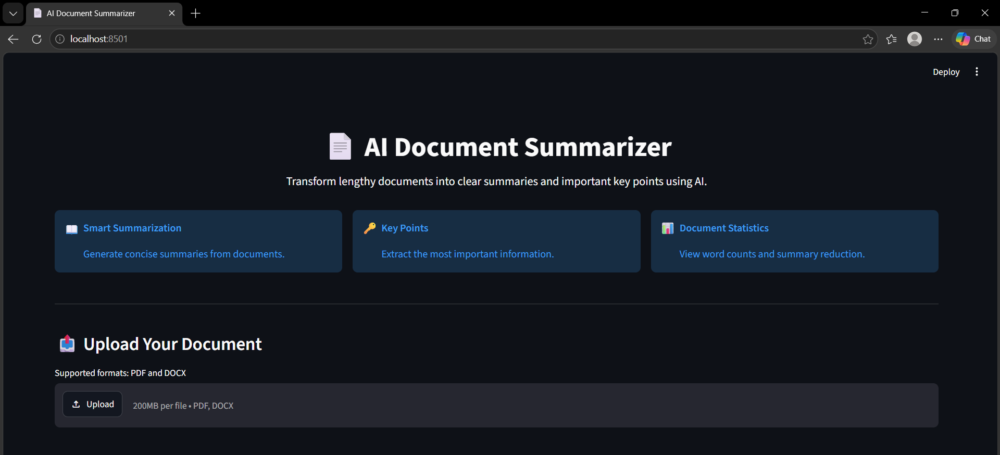
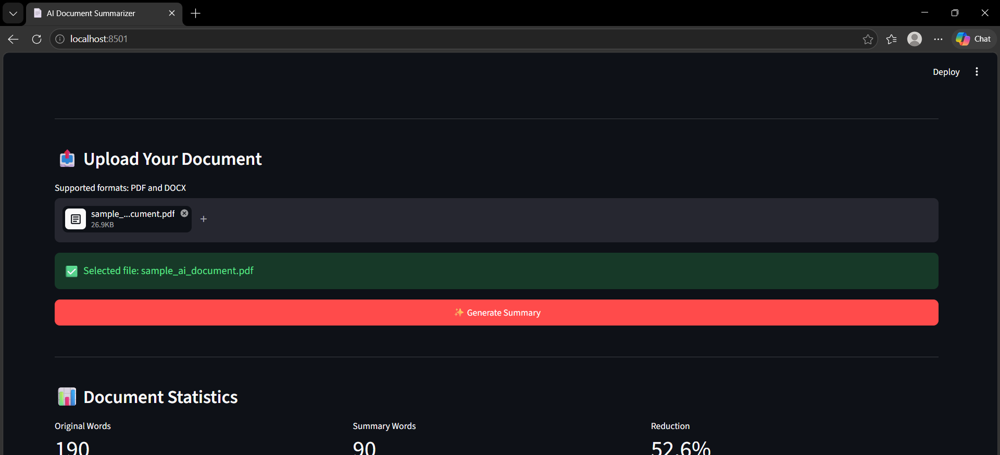
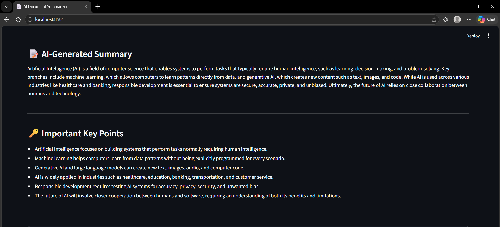

# 📄 AI-Powered Document Summarizer

An AI-powered web application that summarizes PDF and DOCX documents and extracts important key points using Google's Gemini AI.

## 🚀 Project Overview

Reading lengthy documents can take a lot of time. This project uses Generative AI to automatically analyze uploaded documents and generate a concise summary along with important key points.

The application provides a simple and user-friendly interface built with Streamlit.

## ✨ Features

- 📄 Upload PDF documents
- 📝 Upload DOCX documents
- 🤖 AI-powered document summarization
- 🔑 Extract important key points
- 📊 Display document statistics
- 📉 Calculate summary reduction percentage
- ⬇️ Download the generated summary as a TXT file
- 🔐 Secure API key management using `.env`
- 💻 Simple and user-friendly Streamlit interface

## 🛠️ Technologies Used

- **Python**
- **Streamlit**
- **Google Gemini AI**
- **Google GenAI SDK**
- **PyMuPDF**
- **python-docx**
- **python-dotenv**

## 🔄 How It Works

```text
PDF / DOCX Document
        ↓
   File Upload
        ↓
  Text Extraction
        ↓
    Gemini AI
        ↓
 ┌──────┴───────┐
 ↓              ↓
Summary      Key Points
 ↓              ↓
 └──────┬───────┘
        ↓
Document Statistics
        ↓
Download Summary


## Screenshots

### Main Page



### Document Upload and Statistics



### AI-Generated Summary and Key Points

